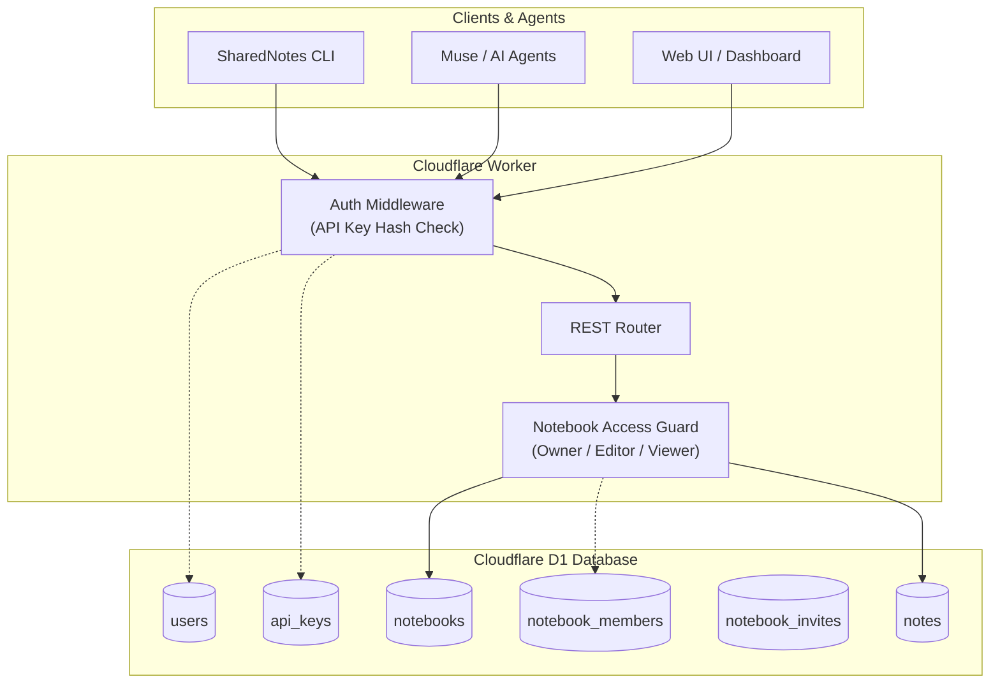
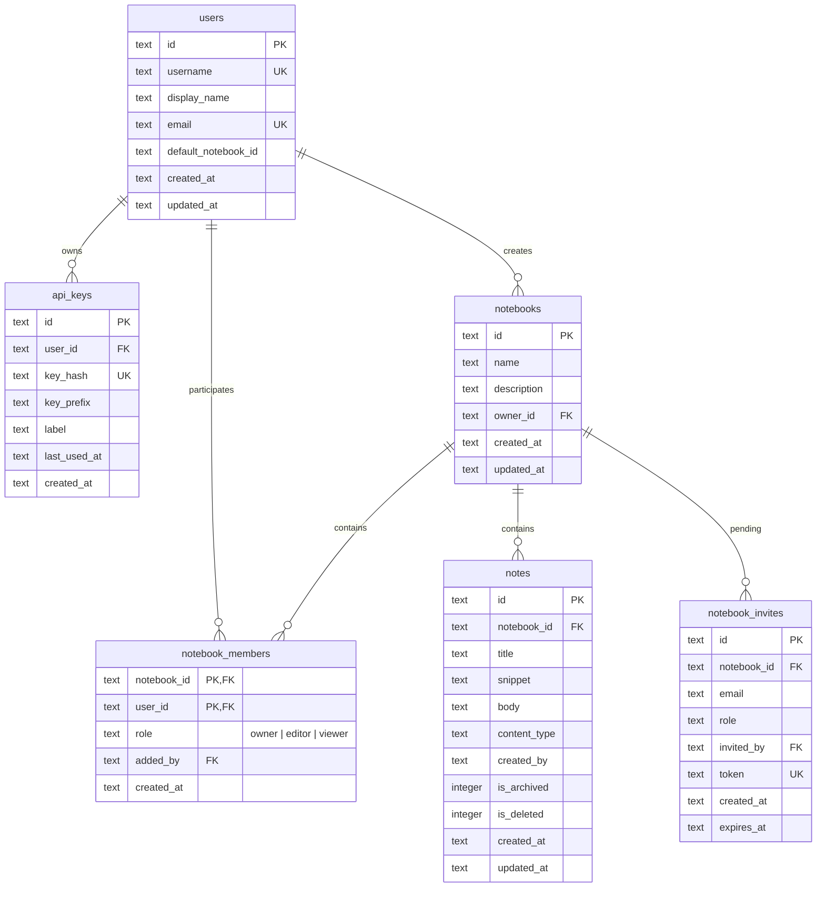
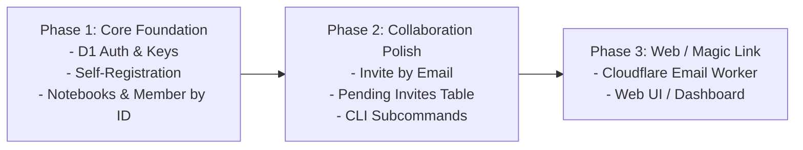

# Architecture RFC: Self-Serve User Signup & Multi-Notebook Access Control

## Executive Summary

SharedNotes currently uses static environment variables (`API_KEYS`, `KEY_OWNERS`, `KEY_ROLES`) for authentication and operates on a single flat pool of notes. To scale to new users and teams, we need to:
1. **Transition from static secrets to database-backed authentication** in Cloudflare D1, allowing frictionless self-registration.
2. **Introduce Notebooks as first-class isolation boundaries**, allowing users to own multiple notebooks and share them with specific members.
3. **Provide granular membership controls** (Owner, Editor, Viewer) managed by user ID (Phase 1) and email invites (Phase 2).
4. **Preserve full backward compatibility** for existing agents, the Muse connector (`connector.zip`), the CLI, and current notes.



---

## 1. Authentication: From Static Secrets to Dynamic Self-Signup

### Current State vs. Target State

| Dimension | Current Architecture | Target Dynamic Architecture |
|---|---|---|
| **Storage** | Worker environment secrets (`API_KEYS`) | Cloudflare D1 (`users` and `api_keys` tables) |
| **User Onboarding** | Manual: CLI key rotation + `wrangler secret put` + re-deploy | Automatic: Self-service via API endpoint, CLI, or web UI |
| **Key Storage** | Plaintext in Worker environment | Hashed using SHA-256 (prefix stored for display/identification) |
| **Revocation & Multi-Key** | All-or-nothing redeployment | Instant row deletion per key or per user |
| **Agent / Fallback** | Hardcoded | Fallback bootstrap key supported via env secret for recovery |

### API Key Security Format
Follow modern API key best practices (similar to GitHub / Stripe):
- Format: `sn_live_<32_random_alphanumeric_chars>`
- Stored fields:
  - `key_prefix`: e.g. `sn_live_a1b2c3` (first 14 chars, displayed in UI/CLI as `sn_live_a1b2c3••••••••`)
  - `key_hash`: SHA-256 hash of the entire raw key string
- When a request arrives with `Authorization: Bearer <raw_key>`:
  1. Hash the incoming token with SHA-256 using WebCrypto `crypto.subtle.digest()`.
  2. Query `api_keys` by `key_hash`.
  3. Look up associated `users` row.

---

## 2. Self-Registration Models

### Option Comparison

| Model | User Experience | AI Agent / CLI Experience | Infrastructure Requirement | Recommended Phase |
|---|---|---|---|---|
| **Option A: Direct API Key Self-Signup** | Enter username & display name &rarr; instant key | Instant 1-step command (`sharednotes register`) | Pure D1 (No third-party service) | **Phase 1 (Immediate)** |
| **Option B: Email Magic Link / OTP** | Enter email &rarr; click link / enter 6-digit code | Web dashboard generates API key for agent | Cloudflare Email Routing / Mailchannels / Resend | **Phase 2** |
| **Option C: OAuth / Social Login** | "Sign in with Google / GitHub" | Requires Device Code flow or web portal | OAuth Client ID/Secret | **Phase 3 (If building full Web UI)** |

### Recommended Phase 1 Implementation: Direct Self-Registration
An open or invite-gated registration endpoint:
- **`POST /auth/register`**
  ```json
  {
    "username": "sarah",
    "display_name": "Sarah Connor",
    "email": "sarah@example.com",
    "invite_code": "optional_pre_shared_secret"
  }
  ```
- **Response (`201 Created`)**:
  ```json
  {
    "user": {
      "id": "usr_94b1a8c2",
      "username": "sarah",
      "display_name": "Sarah Connor",
      "email": "sarah@example.com"
    },
    "api_key": "sn_live_8f0a2e7c9b1d4a3e...",
    "default_notebook": {
      "id": "nb_personal_94b1a8c2",
      "name": "Sarah's Personal Notebook",
      "role": "owner"
    }
  }
  ```
> [!IMPORTANT]
> The raw `api_key` is returned **only once** at creation. The user/CLI stores it locally.

> [!TIP]
> **Spam / Abuse Protection**: An optional environment secret `REGISTRATION_INVITE_CODE` can be set in `wrangler.jsonc`. If configured, registration requests must provide a matching `invite_code`. If unset, registration can be open or disabled.

---

## 3. Notebooks & Membership Access Control

### Data Model



### Roles and Permissions Matrix

| Capability | Notebook Owner | Editor | Viewer |
|---|:---:|:---:|:---:|
| **Read Notes** (`GET /notes`, `GET /notes/:id`) | :white_check_mark: | :white_check_mark: | :white_check_mark: |
| **Create Notes** (`POST /notes`) | :white_check_mark: | :white_check_mark: | :x: |
| **Update Notes** (`PUT /notes/:id`) | :white_check_mark: | :white_check_mark: | :x: |
| **Archive / Unarchive Notes** | :white_check_mark: | :white_check_mark: | :x: |
| **Soft Delete Notes** | :white_check_mark: | :white_check_mark: | :x: |
| **Restore Deleted Notes** | :white_check_mark: | :white_check_mark: | :x: |
| **Hard / Permanent Delete Notes** | :white_check_mark: | :x: | :x: |
| **Add / Remove Members** | :white_check_mark: | :x: | :x: |
| **Change Member Roles** | :white_check_mark: | :x: | :x: |
| **Rename or Delete Notebook** | :white_check_mark: | :x: | :x: |

---

## 4. REST API Specification for Notebooks & Members

### Notebook Management

#### 1. List User's Notebooks
- **`GET /notebooks`**
- Returns all notebooks the authenticated user is a member of, along with their role:
```json
{
  "notebooks": [
    {
      "id": "nb_shared_001",
      "name": "Team Knowledge",
      "description": "Shared operational notes",
      "owner_id": "usr_alice",
      "my_role": "owner",
      "member_count": 3,
      "updated_at": "2026-11-01T12:00:00Z"
    },
    {
      "id": "nb_personal_bob",
      "name": "Bob's Research",
      "description": "Personal workbench",
      "owner_id": "usr_bob",
      "my_role": "editor",
      "member_count": 2,
      "updated_at": "2026-11-01T10:15:00Z"
    }
  ]
}
```

#### 2. Create Notebook
- **`POST /notebooks`**
- Request:
  ```json
  { "name": "Project Apollo", "description": "Notes for Apollo launch" }
  ```
- Action: Creates notebook, assigns caller as `owner` in `notebook_members`.

#### 3. Update Notebook
- **`PUT /notebooks/:id`** *(Owner only)*
- Update name or description.

#### 4. Delete Notebook
- **`DELETE /notebooks/:id`** *(Owner only)*
- Cascade deletes notes and member associations.

---

### Membership Controls

#### 1. List Members
- **`GET /notebooks/:id/members`**
- Returns member list:
```json
{
  "members": [
    { "user_id": "usr_alice", "username": "alice", "display_name": "Alice", "role": "owner" },
    { "user_id": "usr_bob", "username": "bob", "display_name": "Bob", "role": "editor" }
  ],
  "pending_invites": [
    { "id": "inv_123", "email": "newuser@example.com", "role": "viewer", "expires_at": "2026-11-08T00:00:00Z" }
  ]
}
```

#### 2. Add / Invite Member
- **`POST /notebooks/:id/members`** *(Owner only)*
- Supports either `user_id` / `username` (immediate membership) or `email` (immediate if user exists, or pending invite if user hasn't signed up yet):
  ```json
  {
    "user_id": "usr_bob",
    "role": "editor"
  }
  ```
  Or by username / email:
  ```json
  {
    "email": "collaborator@company.com",
    "role": "viewer"
  }
  ```
- **Behavior**:
  - If `user_id` / `username` is provided: adds directly to `notebook_members`.
  - If `email` matches an existing registered user: resolves `user_id` and adds to `notebook_members`.
  - If `email` is not registered yet: creates a row in `notebook_invites`. When that email signs up later via `/auth/register`, pending invites automatically convert into memberships!

#### 3. Update Member Role
- **`PUT /notebooks/:id/members/:user_id`** *(Owner only)*
  ```json
  { "role": "viewer" }
  ```

#### 4. Remove Member
- **`DELETE /notebooks/:id/members/:user_id`**
- Allowed if caller is the `owner` (removing someone else) or if caller is removing themselves (leaving the notebook).

---

## 5. Integrating Notebooks with Existing Note Operations

### Note Routing & Context Efficiency

One of SharedNotes' primary design tenets is **protecting agent prompt context** through token-efficient listing, snippets, and delta syncs.

We preserve this by allowing notebooks to be specified in three ways:

1. **Explicit Query Param**:
   `GET /notes?notebook_id=nb_shared_001`
2. **Explicit Header** (Ideal for Agent Connectors / CLI):
   `X-Notebook-ID: nb_shared_001`
3. **Default Fallback**:
   If no notebook is specified, the server uses the user's `default_notebook_id` (set on registration to their personal notebook or the shared workspace).

### Note Creation & Access Check
When `POST /notes` is called:
```sql
SELECT role FROM notebook_members WHERE notebook_id = ? AND user_id = ?;
```
If role is `owner` or `editor`, allow write. If role is `viewer`, return `403 Forbidden` (`{"error": "insufficient_permissions", "message": "Viewers cannot create or edit notes in this notebook"}`).

When `GET /notes/:id` is called:
```sql
SELECT n.* FROM notes n
JOIN notebook_members m ON n.notebook_id = m.notebook_id
WHERE n.id = ? AND m.user_id = ?;
```
If no row is returned, return `404 Not Found` (avoids leaking note existence to non-members).

---

## 6. Migration & Backward Compatibility Plan

To ensure zero downtime and keep existing tools (CLI, Muse connector, tests) working during rollout:

### Step 1: Database Migration (`migrations/0004_auth_and_notebooks.sql`)
1. Create tables: `users`, `api_keys`, `notebooks`, `notebook_members`, `notebook_invites`.
2. Seed initial users for existing `KEY_OWNERS` (e.g. `alice`, `bob`).
3. Seed a primary shared notebook: `id = 'nb_default_shared'`, `name = 'Shared Notes'`.
4. Add `alice` and `bob` as `owner`/`editor` of `nb_default_shared`.
5. Add column to `notes`:
   ```sql
   ALTER TABLE notes ADD COLUMN notebook_id TEXT NOT NULL DEFAULT 'nb_default_shared';
   CREATE INDEX IF NOT EXISTS idx_notes_notebook ON notes(notebook_id, is_deleted, is_archived, updated_at DESC);
   ```

### Step 2: Backward Compatible Authentication Shim
In `authenticate(request, env)`:
1. First, check if the bearer token matches dynamic `api_keys` in D1.
2. If not found, fall back to checking legacy `env.API_KEYS`. If matched, map to the seeded user (`alice`, `bob`).
3. This guarantees all existing scripts and Muse integrations continue working without immediate key rotation.

---

## 7. CLI & Developer Experience Additions

The `bin/cli.js` tool can be expanded with clean subcommands:

```sh
# Self-registration
$ sharednotes signup --username=alice --name="Alice Smith"

# Notebook management
$ sharednotes notebooks list
$ sharednotes notebooks create --name="Backend Brainstorming"
$ sharednotes notebooks switch <notebook-id>   # sets active notebook in local config

# Membership management
$ sharednotes members list --notebook=<id>
$ sharednotes members add <user_id_or_email> --role=editor --notebook=<id>
$ sharednotes members remove <user_id> --notebook=<id>
```

---

## 8. Phased Implementation Roadmap



1. **Phase 1 (Foundation)**:
   - D1 migration for `users`, `api_keys`, `notebooks`, `notebook_members`, and `notes.notebook_id`.
   - Dynamic API key authentication + legacy env fallback.
   - `POST /auth/register` self-serve registration.
   - Notebook CRUD endpoints and member management by `user_id`/`username`.
   - Update existing note CRUD to enforce notebook memberships.

2. **Phase 2 (Sharing by Email & CLI)**:
   - Add `notebook_invites` table.
   - Support adding members by email (instant resolve if user exists, pending invite if user has not yet registered).
   - Add CLI subcommands for `signup`, `notebooks`, and `members`.

3. **Phase 3 (Optional UI & Passwordless Magic Links)**:
   - Email verification / Magic link authentication via Cloudflare Email Routing or Resend.
   - Simple web interface for non-technical team members to view notes and accept invites.
